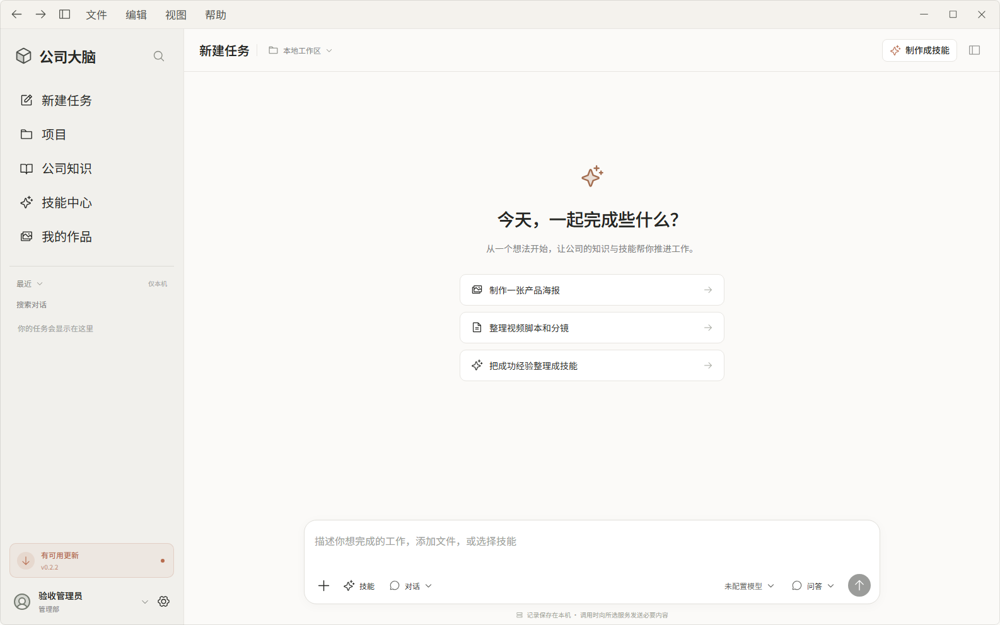
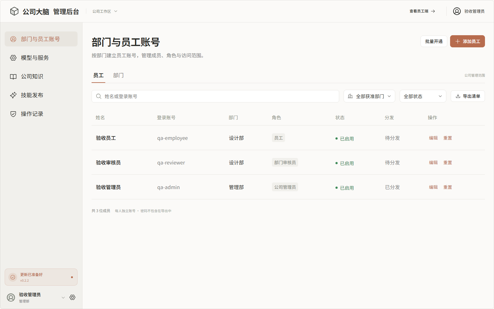
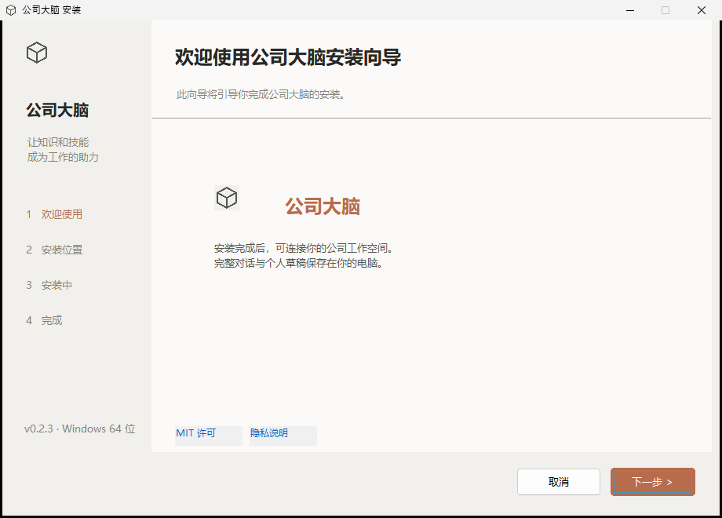
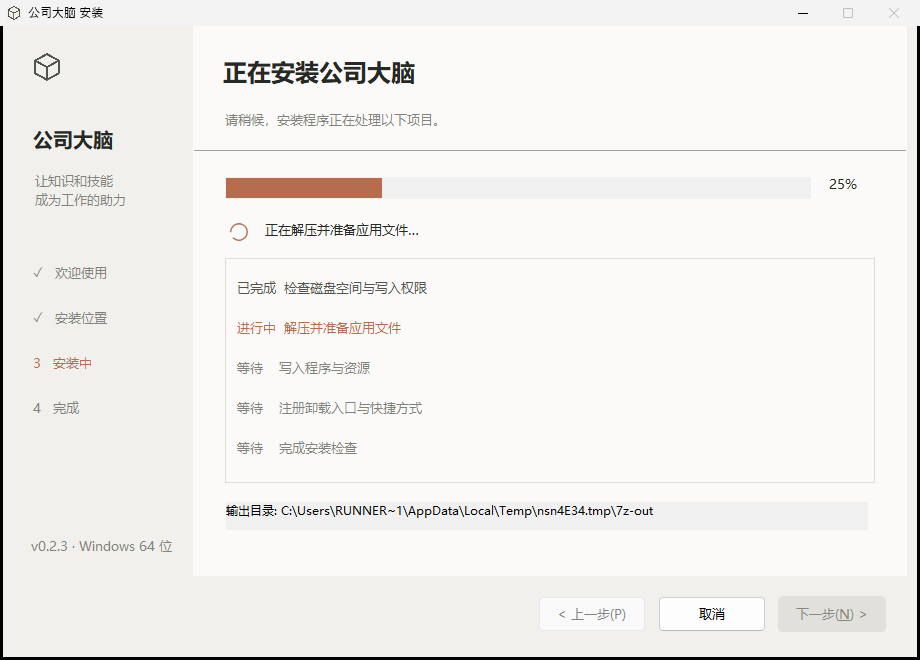

# Corporate Brain 公司大脑

面向公司员工的 AI 创作与工作平台，包含 Windows 客户端、macOS 客户端、员工网页端和浏览器管理后台。

当前开发测试版本为 v0.2.6：员工网页端、Windows/macOS 桌面外壳和管理后台可运行，部门账号、文本型 Skill 的提交发布安装及客户端更新入口已接通。Windows 四步安装向导启动时居中，欢迎页字体和许可链接已按内容区重新对齐，临时目录空间检查会显示实际可用与需要的空间。真实模型、视频、NAS 和完整 Agent 执行仍按阶段推进，详见[开发状态与验证记录](docs/DEVELOPMENT-STATUS.md)。

## 界面预览

以下图片来自实际运行中的员工客户端、管理后台和 Windows 安装器，已去除账号密钥、员工对话和公司资料。安装器截图展示欢迎页与真实安装进度页；正式安装包请从 [Releases](https://github.com/taorobotics/Corporate-Brain/releases/latest) 下载。

<p align="center">
  
  
</p>

<p align="center">
  
  
</p>

## 开源与签名状态

原创代码采用 [MIT License](LICENSE)，允许使用、修改与商用并保留声明。第三方组件保留各自许可，见 [THIRD_PARTY_NOTICES.txt](THIRD_PARTY_NOTICES.txt) 和[锁定依赖清单](docs/dependency-licenses.json)。真实账号、密钥、聊天、内部 Skills 和公司资料不属于开源分发内容。package.json 的 private: true 用于防止误发布到 npm，不代表源码许可证禁止公开。

[Code signing policy](docs/CODE_SIGNING_POLICY.md) · [隐私说明](docs/PRIVACY.md) · [安全报告](SECURITY.md) · [开源与签名准备清单](docs/OPEN-SOURCE-READINESS.md) · [申请材料](docs/SIGNPATH-APPLICATION.md)。当前尚未向 SignPath 提交或获批，Windows 仍未取得可信签名，Mac 仍为 ad-hoc 签名。公开和加入免费签名服务分别需要维护者确认与服务方审核。

## 下载 Windows / macOS 测试版

在仓库首页右侧点击 **Releases**，进入版本页后在 **Assets** 下载客户端：

- [最新版下载页](https://github.com/taorobotics/Corporate-Brain/releases/latest)：后续新版本继续使用这个入口。
- [全部版本与更新说明](https://github.com/taorobotics/Corporate-Brain/releases)：保留各版本独立的安装包和说明。

最新已发布版本以 Releases/latest 为准，在 Assets 选择以下文件；文件名中的 X.Y.Z 为对应版本：

| 电脑或用途 | 下载文件 |
| --- | --- |
| Windows x64 | Corporate-Brain-Setup-X.Y.Z-x64.exe |
| Mac Apple 芯片 | Corporate-Brain-X.Y.Z-macOS-arm64.dmg |
| Mac Intel | Corporate-Brain-X.Y.Z-macOS-x64.dmg |
| 公司服务器更新 | Corporate-Brain-Server-X.Y.Z.zip |
| 安装与更新包校验 | SHA256SUMS.txt |

服务器更新包从 v0.1.1 开始提供。客户端从公司服务器加载界面，界面或业务服务更新还需由管理员同步部署服务器包，不能只重新安装客户端。

这些是开发测试版。Windows 尚未签名；Mac 使用 ad-hoc 签名，尚无 Apple Developer ID 签名和公证，下载后可能出现系统安全提示。Mac 打开 DMG 后将“公司大脑”拖入 Applications（应用程序），安装和检查范围见 [macOS 分发说明](docs/MACOS-RELEASE.md)。源码和安装包的访问权限以仓库当前可见性为准；仓库为私有时需要 GitHub 授权。

安装后填写管理员提供的公司服务器地址，再使用公司分配的账号登录。管理后台与业务服务需单独部署；安装包不包含服务器数据库、预设账号或公司密钥。本机开发测试可先按下文启动服务，使用 http://127.0.0.1:4173 作为客户端连接地址。

从 v0.2.0 起，客户端登录后自动检查新版本，左侧底部显示更新入口，可查看说明、下载、校验并主动打开安装程序；0.1.x 客户端先手动安装一次新版。公司服务器需同步升级，并在服务器环境配置一次 BRAIN_GITHUB_TOKEN（私有仓库 Contents: read）；凭据不分发给员工。详见[更新配置](docs/DEPLOYMENT.md#客户端更新源)。仓库右侧的 Packages 用于 npm 等依赖包或容器镜像，Windows 和 Mac 安装包统一放在 Releases。

每批更新都发布独立版本：小更新递增补丁位，中更新递增次版本位，大更新递增主版本位。使用 npm run version:bump -- patch|minor|major 同步版本，标签触发 Desktop release，检查和资源核对通过后才公开发布。详见[发版规则](docs/RELEASE-POLICY.md)。

## 本地运行

使用 Node.js 24.13 或更高版本。所有命令在本项目根目录执行。

```powershell
npm ci
npm run dev
```

访问 http://127.0.0.1:4173。首次访问创建管理员，不提供固定默认密码；随后在管理后台建立部门、单个或批量开通员工账号。初始密码 24 小时有效，员工首次登录须改密。

保持服务运行，在另一个终端启动桌面开发版：

```powershell
npm run desktop
```

打包客户端首次打开时填写公司服务器地址。正式员工客户端连接统一公司服务器，员工电脑无需安装业务数据库或各自部署公司后端。当前客户端从公司服务器加载员工界面，个人记录仍由桌面本地存储保存；离线冷启动尚未实现。

## 构建、检查与部署准备

```powershell
npm test
npm run build
npm run test:desktop
npm run test:dsh
npm run package:win
```

Windows 安装包输出到 release；macOS 可在 Mac 上运行 npm run package:mac。正式版本使用 GitHub Actions 的“Desktop release”统一构建 Windows、两种 Mac 包和公司服务器更新包。Mac 构建流程包含原生桌面操作和打包程序启动检查，仍需员工物理设备的下载、文件授权、升级与卸载验收。当前安装包供开发测试，未做正式代码签名与 Apple 公证。桌面包独立于服务器依赖，开发测试和第三方分析缓存不打包给员工。

Windows 安装器采用四步原生向导，新装优先推荐固定、可写的 D 盘，覆盖升级保留原路径；卸载保留本机个人记录。构建该安装器另需 Visual C++ x86 工具和 Windows SDK，员工安装无需这些开发工具。构建方式与隔离环境中的真实安装、升级、卸载检查见 [Windows 安装向导](docs/WINDOWS-INSTALLER.md)。

构建后可用 npm start 启动带静态界面的公司业务服务，默认只监听本机 4310 端口。[部署说明](docs/DEPLOYMENT.md)记录公司服务器地址、HTTPS、数据与备份边界。真实接口配置前，开发程序不显示伪造生成结果。

## 开发依据

- [产品需求文档](docs/PRD.md)：范围、角色权限、业务流程、异常处理、验收标准和待补参数。
- [UI 规范与已确认效果图](docs/UI-SPEC.md)：页面规则、图稿来源及最终版本。
- [实施计划](docs/IMPLEMENTATION-PLAN.md)：技术验证、开发任务、依赖和交付关卡。
- [开发状态](docs/DEVELOPMENT-STATUS.md)：已实现、已验证与仍未完成的部分。

首版必须打通：员工登录 → 使用获准模型和资料 → 生成并保存成果 → 对话转 Skill → 审核发布 → 其他员工安装复用。

完整对话、个人项目和 Skill 草稿保存在员工本机，按公司与员工账号隔离，不自动上传服务器、NAS 或其他设备。平台只接收员工主动提交的 Skill 包、明确选择的共享资料和必要任务输入；其他员工安装的是可复用技能，其使用记录仍保存在自己的设备。

调用模型时仍需发送本次必要上下文；后台保存账号、权限、共享项目、知识、已提交技能及必要任务状态，不集中保存员工聊天历史。员工网页端使用浏览器本地存储，换设备不自动带出旧聊天，本地记录通过主动导出导入迁移。

部门是账号管理与 Skill 分发的基本单位：按部门为每位员工单个或批量开通独立账号、分发初始临时密码，首次登录改密。Skill 默认提交本部门，也可申请共享给指定多个部门或全公司，由对应权限的审核员批准。调部门调整共享资源权限，保留个人本地记录；已有部门技能归属不随作者自动迁移。

未接通的能力须明确显示未配置或不可用。演示数据、模拟任务和真实调用须清楚区分。
